# Machine Learning for Event Classification in ATLAS Open Data

Application of machine-learning techniques to signal-background classification in simulated **ATLAS Open Data**, focusing on the Higgs boson dimuon decay channel $H \rightarrow \mu^+\mu^-$.

This repository contains the analysis developed as part of my bachelor's thesis in the **Department of Physics at the National and Kapodistrian University of Athens**.

## Contents

- [Overview](#overview)
- [Physics Motivation](#physics-motivation)
- [Dataset](#dataset)
- [Analysis Workflow](#analysis-workflow)
- [Event Selection](#event-selection)
- [Event Categories and Input Features](#event-categories-and-input-features)
- [Machine Learning Methods](#machine-learning-methods)
- [Training and Model Selection](#training-and-model-selection)
- [Results](#results)
- [Repository Structure](#repository-structure)
- [Reproducing the Analysis](#reproducing-the-analysis)
- [Tools and Technologies](#tools-and-technologies)
- [Bachelor's Thesis](#bachelors-thesis)
- [License](#license)
- [Author](#author)

## Overview

The project investigates the application of supervised machine-learning techniques to event classification in High-Energy Physics. The main objective is to distinguish simulated Higgs boson signal events from the dominant dimuon background using kinematic information reconstructed from the final-state particles.

The analysis focuses on the $H \rightarrow \mu^+\mu^-$ decay channel and uses simulated ATLAS Open Data corresponding to proton-proton collisions at the Large Hadron Collider (LHC). Signal samples include different Higgs boson production mechanisms, while the background is dominated by $Z/\gamma^* \rightarrow \mu^+\mu^-$ production.

Events are divided into three categories according to their reconstructed jet multiplicity:

- $n_j = 0$
- $n_j = 1$
- $n_j \geq 2$

Different sets of kinematic variables and machine-learning classifiers are investigated for each category. Model hyperparameters are selected using cross-validation, and the final classifiers are evaluated on independent test samples using ROC curves and the Area Under the ROC Curve (AUC).

## Physics Motivation

The decay of the Higgs boson into a pair of muons provides direct access to the interaction between the Higgs field and second-generation fermions. Experimentally, however, the $H \rightarrow \mu^+\mu^-$ signal must be distinguished from a much larger background dominated by Drell-Yan production of muon pairs through $Z/\gamma^* \rightarrow \mu^+\mu^-$.

Because signal and background events can produce similar reconstructed final states, discrimination cannot rely on a single observable alone. Instead, information from multiple kinematic properties of the dimuon system and, depending on the event category, the associated jets can be combined.

Machine-learning methods provide a natural framework for exploiting these correlations simultaneously. This project therefore compares several supervised classification techniques and evaluates their ability to improve the separation between Higgs boson signal and background events.

## Dataset

The analysis uses **simulated ATLAS Open Data** samples for both signal and background events. All samples are provided in ROOT format and contain reconstructed event information used throughout the analysis.

### Signal

The signal consists of simulated $H \rightarrow \mu^+\mu^-$ events from three Higgs boson production processes:

| Process | Description | DSID |
|---|---|---:|
| ggH | Gluon-gluon fusion | 345097 |
| ggZH | Gluon-induced associated $ZH$ production | 345098 |
| VBF | Vector-boson fusion | 345106 |

### Background

The background consists of simulated $Z/\gamma^* \rightarrow \mu^+\mu^-$ events, divided into three samples:

| Sample | DSID |
|---|---:|
| BFilter | 700323 |
| CFilterBVeto | 700324 |
| CVetoBVeto | 700325 |

The three background samples are first skimmed according to reconstructed jet multiplicity and subsequently combined during the construction of the category-specific datasets.

The original ROOT files are not included in this repository because of their size. Detailed information about the samples, including the official ATLAS Open Data filenames, local filenames expected by the analysis, and direct download links, is provided in [`data/README.md`](data/README.md).

## Analysis Workflow

The analysis follows a complete pipeline from the original ATLAS Open Data samples to the final machine-learning comparison.

### 1. Background skimming

The three $Z/\gamma^* \rightarrow \mu^+\mu^-$ background samples are first divided according to reconstructed jet multiplicity:

- $n_j = 0$
- $n_j = 1$
- $n_j \geq 2$

This step is implemented in [`skim_z_background.cpp`](src/data_preparation/skim_z_background.cpp).

### 2. Event selection and dataset construction

Signal and background events are processed independently for each jet category. The corresponding data-preparation programs perform the event selection, reconstruct the relevant kinematic quantities, calculate the physical event weights, and produce the ROOT trees used as input to TMVA.

The category-specific datasets are constructed with:

- [`build_nj0_dataset.cpp`](src/data_preparation/build_nj0_dataset.cpp)
- [`build_nj1_dataset.cpp`](src/data_preparation/build_nj1_dataset.cpp)
- [`build_nj2plus_dataset.cpp`](src/data_preparation/build_nj2plus_dataset.cpp)

The dimuon invariant-mass window used in the analysis is

$$
120~\mathrm{GeV} < m_{\mu\mu} < 130~\mathrm{GeV}.
$$

### 3. Machine-learning training and optimization

The selected events are used to train supervised classifiers with the **Toolkit for Multivariate Data Analysis (TMVA)** within ROOT.

Model hyperparameters are investigated using **5-fold cross-validation**, while a fixed train/test split is retained for the final evaluation. The optimization is performed independently for the different jet categories and classifiers.

### 4. Final model comparison

After hyperparameter selection, the final classifiers are retrained using their selected configurations and evaluated on the corresponding common test samples.

The final comparison programs are:

- [`compare_models_nj0.cpp`](src/analysis/compare_models_nj0.cpp)
- [`compare_models_nj1.cpp`](src/analysis/compare_models_nj1.cpp)
- [`compare_models_nj2plus.cpp`](src/analysis/compare_models_nj2plus.cpp)

Classifier performance is evaluated primarily through **Receiver Operating Characteristic (ROC) curves** and the corresponding **Area Under the Curve (AUC)**.

### Pipeline

```text
ATLAS Open Data
       │
       ▼
Background skimming
       │
       ▼
Event selection and reconstruction
       │
       ▼
Event weighting and normalization
       │
       ▼
Jet categorization
(n_j = 0, 1, >= 2)
       │
       ▼
Feature construction
       │
       ▼
TMVA model training
       │
       ├── 5-fold cross-validation
       │
       └── Hyperparameter selection
       │
       ▼
Final training and testing
       │
       ▼
ROC curves and AUC comparison
```

## Event Selection

Before the machine-learning stage, a common event selection is applied to the simulated signal and background samples to construct the dimuon candidates used in the analysis.

### Muon selection

Reconstructed muons are initially required to satisfy:

- muon identification: $|\mathrm{lep\_type}| = 13$
- transverse momentum: $p_T > 10~\mathrm{GeV}$
- Loose identification criteria

From the available muons, opposite-sign pairs are considered. The dimuon candidate is selected by prioritizing the pair with the highest leading-muon transverse momentum and subsequently the highest subleading-muon transverse momentum.

The two selected muons are then required to satisfy:

- leading-muon $p_T > 27~\mathrm{GeV}$
- subleading-muon $p_T > 15~\mathrm{GeV}$
- $|\eta| < 2.5$ for both muons
- $|z_0/\cosh(\eta)| < 0.5$
- transverse impact-parameter significance $|d_0/\sigma(d_0)| < 3$
- Loose isolation criteria for both muons
- at least one of the two muons must be trigger-matched

Events containing an additional stored electron or muon satisfying $p_T > 7~\mathrm{GeV}$ and the Loose identification criteria are rejected.

### Dimuon mass region

The invariant mass of the selected muon pair is reconstructed and events are restricted to the Higgs-boson mass region

$$
120~\mathrm{GeV} < m_{\mu\mu} < 130~\mathrm{GeV}.
$$

The dimuon invariant mass is used only as a selection quantity and is not provided to the machine-learning classifiers as an input feature.

### Jet categorization

After the common dimuon selection, events are assigned to three mutually exclusive categories according to their reconstructed jet multiplicity:

- $n_j = 0$
- $n_j = 1$
- $n_j \geq 2$

The category-specific datasets are constructed independently, allowing different sets of kinematic variables and classifiers to be investigated for each jet topology.

### Event weights

Each selected event is assigned a physical event weight constructed from the Monte Carlo event weight, the relevant muon, trigger, and pileup scale factors, and the normalization of the corresponding simulated process:

$$
w_{\mathrm{event}}
=
w_{\mathrm{MC}}
\times
SF_{\mu}
\times
SF_{\mathrm{trigger}}
\times
SF_{\mathrm{pileup}}
\times
\frac{\sigma\,k\,\epsilon_{\mathrm{filter}}}
{\sum w_{\mathrm{MC}}}.
$$

The same event weights are subsequently used during the TMVA training and evaluation stages.

The complete implementation of the selection, event weighting, and feature construction is available in the category-specific data-preparation programs under [`src/data_preparation/`](src/data_preparation/).

## Event Categories and Input Features

Events are divided into three mutually exclusive categories according to the number of reconstructed jets, $n_j$. The available kinematic information increases with jet multiplicity, leading to a different set of input variables for each category.

| Category | Number of input features | Information used |
|---|---:|---|
| $n_j = 0$ | 3 | Dimuon kinematics |
| $n_j = 1$ | 6 | Dimuon + leading-jet kinematics |
| $n_j \geq 2$ | 15 | Dimuon + two leading jets + dijet and global event kinematics |

### $n_j = 0$

For events without reconstructed jets, the classification is based on three properties of the dimuon system:

- `pT_mumu` — transverse momentum of the dimuon system
- `Y_mumu` — rapidity of the dimuon system
- `cosTheta` — Collins-Soper angular variable

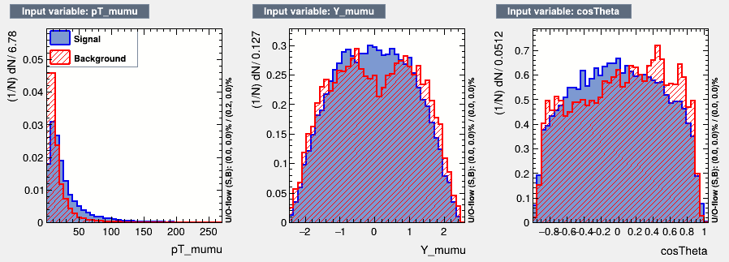

### $n_j = 1$

For events containing exactly one reconstructed jet, three jet-related quantities are added to the dimuon variables:

- `pT_mumu`
- `Y_mumu`
- `cosTheta`
- `jet1_pt` — transverse momentum of the leading jet
- `jet1_eta` — pseudorapidity of the leading jet
- `dPhi_mumu_j1` — azimuthal-angle separation between the dimuon system and the leading jet

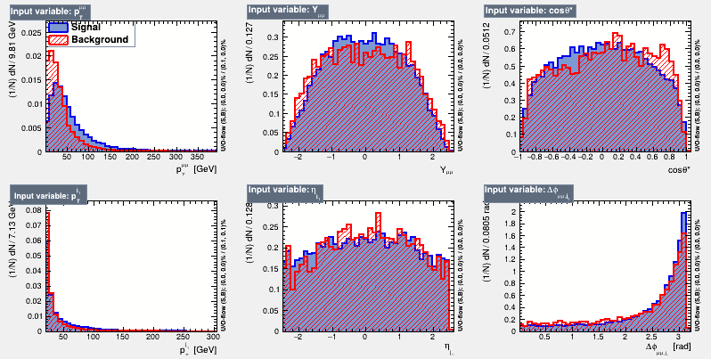

### $n_j \geq 2$

For events containing at least two reconstructed jets, the feature space is extended to 15 variables:

**Dimuon system**

- `pT_mumu`
- `Y_mumu`
- `cosTheta`

**Leading jets**

- `jet1_pt`
- `jet1_eta`
- `dPhi_j1_mumu`
- `jet2_pt`
- `jet2_eta`
- `dPhi_j2_mumu`

**Dijet system and global event properties**

- `pT_jj` — transverse momentum of the dijet system
- `Y_jj` — rapidity of the dijet system
- `dPhi_jj_mumu` — azimuthal-angle separation between the dijet and dimuon systems
- `m_jj` — dijet invariant mass
- `met` — missing transverse energy
- `HT` — scalar sum of the transverse momenta of the reconstructed jets

The corresponding input-variable distributions are divided into three figures for readability:

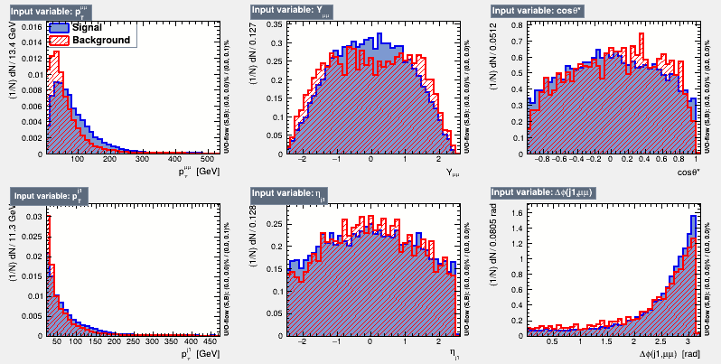

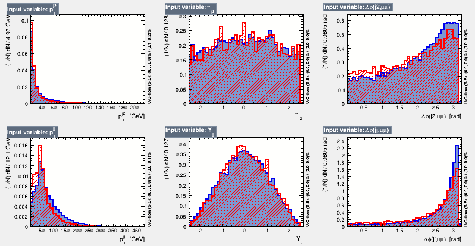

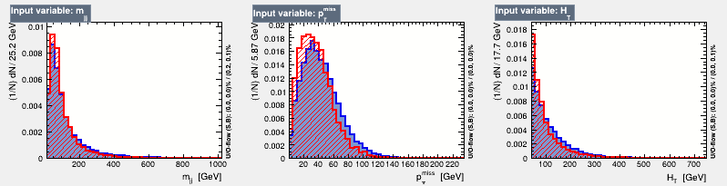

The dimuon invariant mass, $m_{\mu\mu}$, is used for event selection but is not provided to the classifiers as an input feature.

## Machine Learning Methods

The classification study is implemented using the **Toolkit for Multivariate Data Analysis (TMVA)** provided within the ROOT framework.

For the $n_j = 0$ category, six supervised classification methods are investigated, covering a range of approaches from classical statistical techniques to neural networks and ensemble methods:

| Method | TMVA implementation |
|---|---|
| Fisher Discriminant | Fisher |
| Projective Likelihood | Likelihood |
| k-Nearest Neighbours | kNN |
| Multilayer Perceptron | MLP |
| Deep Neural Network | DNN |
| Boosted Decision Trees | BDT |

This broader comparison is used to study the performance of different classification approaches when only the three dimuon kinematic variables are available.

For the $n_j = 1$ and $n_j \geq 2$ categories, the analysis focuses on two more flexible classifiers:

- **Deep Neural Network (DNN)**
- **Boosted Decision Trees (BDT)**

These categories contain a larger number of input features describing the dimuon system, reconstructed jets, and — for $n_j \geq 2$ — the dijet system and global event properties.

The implementation of each classifier is available in the category-specific directories under [`src/models/`](src/models/):

```text
src/models/
├── nj0/
│   ├── fisher.cpp
│   ├── likelihood.cpp
│   ├── knn.cpp
│   ├── mlp.cpp
│   ├── dnn.cpp
│   └── bdt.cpp
├── nj1/
│   ├── dnn.cpp
│   └── bdt.cpp
└── nj2plus/
    ├── dnn.cpp
    └── bdt.cpp
```

Each model is optimized independently before the selected configurations are retrained and evaluated on the common test sample of the corresponding event category.

## Training and Model Selection

A common training and evaluation strategy is used across the different event categories to allow a consistent comparison of the machine-learning classifiers.

### Train/Test Split

For each event category, the available signal and background events are randomly divided into:

- **80% training sample**
- **20% independent test sample**

A fixed random seed (`12345`) is used to make the split reproducible. The test sample is kept separate from the hyperparameter-selection procedure and is used for the final evaluation of the selected models.

Physical event weights are incorporated into the TMVA training. Negative-weight events are retained in the datasets but ignored during classifier training using TMVA's `IgnoreNegWeightsInTraining` treatment.

### Hyperparameter Optimization

Model hyperparameters are selected using **5-fold cross-validation** on the training data.

For each candidate configuration, the training sample is divided into five folds. The model is repeatedly trained on four folds and evaluated on the remaining fold, allowing its performance to be estimated without using the final test sample.

The mean validation AUC across the five folds is used as the main criterion for selecting the final configuration.

The optimization includes, depending on the classifier:

- number of bins for the Projective Likelihood
- number of nearest neighbours for kNN
- number of hidden neurons for the MLP
- network architecture for the DNN
- maximum tree depth for the BDT

### Selected Configurations

The optimization procedure results in the following final configurations:

| Category | Classifier | Selected configuration |
|---|---|---|
| $n_j = 0$ | Fisher | Standard Fisher discriminant |
| $n_j = 0$ | Likelihood | 150 bins |
| $n_j = 0$ | kNN | $k = 300$ |
| $n_j = 0$ | MLP | 14 hidden neurons |
| $n_j = 0$ | DNN | 5 hidden layers × 6 neurons |
| $n_j = 0$ | BDT | MaxDepth = 2, 800 trees |
| $n_j = 1$ | DNN | 3 hidden layers × 6 neurons |
| $n_j = 1$ | BDT | MaxDepth = 2, 800 trees |
| $n_j \geq 2$ | DNN | 2 hidden layers × 30 neurons |
| $n_j \geq 2$ | BDT | MaxDepth = 2, 800 trees |

The DNN models use `tanh` activation functions in the hidden layers, a linear output layer, the Adam optimizer, and a learning rate of $10^{-3}$. The BDT models use AdaBoost with `AdaBoostBeta = 0.5` and bagged boosting.

### Overtraining Checks

Possible overtraining was investigated by comparing the classifier-output distributions obtained from the training and test samples. The agreement between the two distributions was additionally quantified using the **Kolmogorov-Smirnov (KS) test**.

Representative train/test comparisons for the selected models are shown below.

#### $n_j = 0$ — MLP

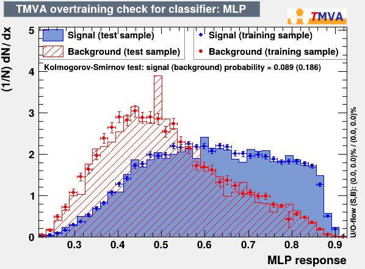

The MLP was selected as the representative model for the $n_j = 0$ category because it achieved the highest final test AUC among the six evaluated classifiers.

#### $n_j = 1$ — DNN

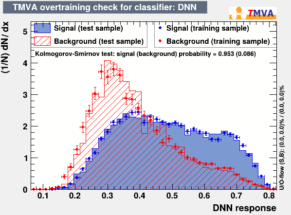

For the $n_j = 1$ category, the DNN classifier shows good agreement between the training and test output distributions, supporting the stability of the selected model configuration.

#### $n_j \geq 2$ — DNN

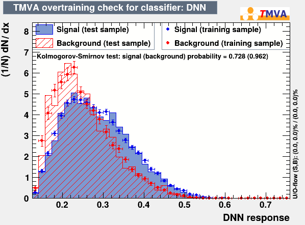

For the $n_j \geq 2$ category, the DNN also shows good agreement between the training and test samples. The corresponding KS probabilities were 0.728 for the signal and 0.962 for the background.

The BDT requires additional consideration in this category. While the signal distributions showed reasonable agreement, the background KS probability was significantly lower ($KS_B = 0.003$), indicating possible overtraining for the background class. Nevertheless, its final test performance remained close to the cross-validation estimate, with $AUC_{\mathrm{test}} = 0.664808$ compared with $AUC_{\mathrm{CV}} = 0.656909$.

These checks were used alongside cross-validation and the independent test sample to assess the generalization behaviour of the final classifier configurations.

## Results

Classifier performance is evaluated using the **Receiver Operating Characteristic (ROC) curve** and the corresponding **Area Under the Curve (AUC)**. The final AUC values are obtained from the held-out test samples after completion of the hyperparameter-selection procedure.

### $n_j = 0$

For the zero-jet category, six different classification methods are compared.

| Classifier | 5-fold CV AUC | Test AUC |
|---|---:|---:|
| Fisher | — | 0.687815 |
| Projective Likelihood | 0.694384 | 0.695086 |
| kNN | 0.693417 | 0.689634 |
| **MLP** | **0.701169** | **0.698529** |
| DNN | 0.697236 | 0.697582 |
| BDT | 0.697216 | 0.697498 |

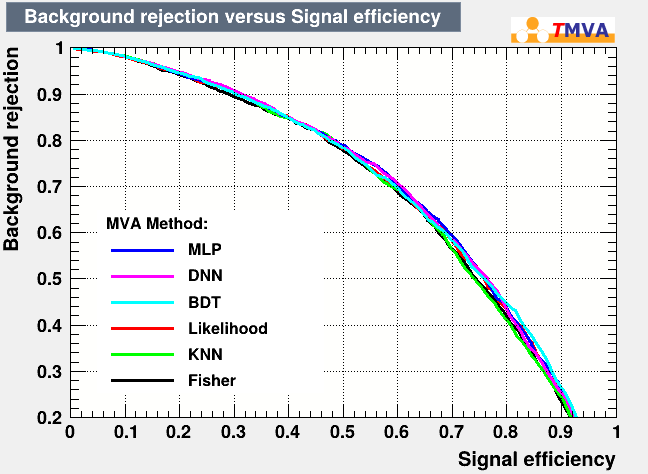

The final test results remain close to the performance estimated during cross-validation. The **MLP achieves the highest test AUC of 0.698529**, although the MLP, DNN, and BDT exhibit very similar overall discrimination performance. The Fisher discriminant gives the lowest test AUC, at 0.687815.

### $n_j = 1$

For events containing exactly one reconstructed jet, the final comparison is performed between the optimized DNN and BDT classifiers.

| Classifier | 5-fold CV AUC | Test AUC |
|---|---:|---:|
| **DNN** | 0.673448 | **0.686130** |
| BDT | **0.680234** | 0.673398 |

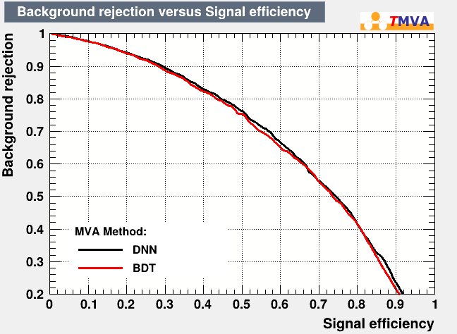

The two classifiers show comparable discrimination performance. While the BDT achieves a slightly higher mean AUC during cross-validation, the **DNN obtains the highest performance on the independent test sample, with an AUC of 0.686130**. The close performance of the two classifiers is also reflected in the substantial overlap of their ROC curves.

### $n_j \geq 2$

For events containing at least two reconstructed jets, the classification uses the full 15-dimensional feature set, incorporating information from the dimuon system, the two leading jets, the dijet system, missing transverse energy, and global event activity.

| Classifier | 5-fold CV AUC | Test AUC |
|---|---:|---:|
| DNN | 0.603158 | 0.620458 |
| **BDT** | **0.656909** | **0.664808** |

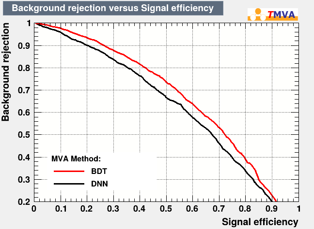

In this category, the **BDT clearly outperforms the DNN**, achieving a test AUC of **0.664808**, compared with **0.620458** for the DNN. The same ordering is observed during cross-validation, indicating that the BDT provides better discrimination for the selected feature set and model configurations in the $n_j \geq 2$ category.

### Overall Comparison

The final results show that no single classifier is universally optimal across all event categories.

For $n_j = 0$, the MLP achieves the highest test AUC, although its performance is very close to that of the DNN and BDT. For $n_j = 1$, the DNN provides the highest final test AUC, while both methods remain broadly comparable. For $n_j \geq 2$, the BDT shows a clearer advantage over the DNN.

Across most of the investigated models, the final test AUC values remain reasonably consistent with the corresponding cross-validation estimates, supporting the generalization of the selected configurations to the independent test samples.

Overall, the study illustrates how the relative performance of machine-learning classifiers depends on the event topology, the available kinematic information, and the model configuration, highlighting the importance of category-specific model optimization in High-Energy Physics analyses.

## Repository Structure

The repository is organized according to the main stages of the analysis:

```text
atlas-higgs-ml-classification/
├── README.md
├── .gitignore
│
├── data/
│   └── README.md
│
├── results/
│   ├── correlations/
│   ├── input_variables/
│   ├── overtraining/
│   └── roc/
│
├── src/
│   ├── analysis/
│   │   ├── compare_models_nj0.cpp
│   │   ├── compare_models_nj1.cpp
│   │   └── compare_models_nj2plus.cpp
│   │
│   ├── data_preparation/
│   │   ├── build_nj0_dataset.cpp
│   │   ├── build_nj1_dataset.cpp
│   │   ├── build_nj2plus_dataset.cpp
│   │   └── skim_z_background.cpp
│   │
│   └── models/
│       ├── nj0/
│       │   ├── bdt.cpp
│       │   ├── dnn.cpp
│       │   ├── fisher.cpp
│       │   ├── knn.cpp
│       │   ├── likelihood.cpp
│       │   └── mlp.cpp
│       │
│       ├── nj1/
│       │   ├── bdt.cpp
│       │   └── dnn.cpp
│       │
│       └── nj2plus/
│           ├── bdt.cpp
│           └── dnn.cpp
│
└── thesis/
    ├── README.md
    └── Pavlos_Panagiotopoulos_Bachelor_Thesis.pdf
```

### Directory Overview

- **[`data/`](data/)** — documentation for the simulated ATLAS Open Data samples used in the analysis, including DSIDs, official filenames, local filenames, and download links. The ROOT data files themselves are not tracked by Git.

- **[`src/data_preparation/`](src/data_preparation/)** — event skimming, physics selection, event weighting, feature construction, and generation of the category-specific datasets.

- **[`src/models/`](src/models/)** — TMVA implementations used for classifier optimization and training, organized by jet-multiplicity category.

- **[`src/analysis/`](src/analysis/)** — final comparison programs that retrain the selected classifiers on common train/test splits and produce the final ROC and AUC comparisons.

- **[`results/`](results/)** — selected figures from the final analysis, including input-variable distributions, correlation matrices, overtraining checks, and ROC comparisons.

- **[`thesis/`](thesis/)** — the complete bachelor's thesis and accompanying documentation.

## Reproducing the Analysis

The analysis is implemented as a collection of C++ macros using **ROOT** and **TMVA**. Large ROOT data files and generated intermediate files are intentionally excluded from version control.

The source programs use relative filenames for their input and output ROOT files. Therefore, the recommended workflow is to use a separate local working directory containing the required data files and execute the analysis macros from that directory.

### 1. Obtain the ATLAS Open Data samples

Download the six simulated ROOT samples used in the analysis:

- three $H \rightarrow \mu^+\mu^-$ signal samples
- three $Z/\gamma^* \rightarrow \mu^+\mu^-$ background samples

The official CERN download links, DSIDs, filenames, and local filenames expected by the analysis are provided in [`data/README.md`](data/README.md).

Rename the downloaded files according to the local filenames documented there.

### 2. Prepare a local working directory

Create a directory outside or inside your local clone in which the ROOT files and generated analysis outputs will be stored.

Before running the analysis, the working directory should contain:

```text
ggH.root
ggZH.root
VBF.root

Zbfilter.root
ZCfilterBveto.root
ZCvetoBveto.root
```

All subsequent generated `.root` files can remain in this working directory. ROOT files are excluded from Git tracking through the repository's `.gitignore`.

### 3. Skim the background samples

Run:

```text
src/data_preparation/skim_z_background.cpp
```

This divides the background events according to reconstructed jet multiplicity and produces:

```text
Zskimmed_nj0.root
Zskimmed_nj1.root
Zskimmed_nj2.root
```

### 4. Construct the category-specific datasets

Run the three dataset-construction programs:

```text
src/data_preparation/build_nj0_dataset.cpp
src/data_preparation/build_nj1_dataset.cpp
src/data_preparation/build_nj2plus_dataset.cpp
```

They apply the event selection, reconstruct the input variables, calculate the event weights, and produce:

```text
nj0_signal.root
nj0_background.root

nj1_signal.root
nj1_background.root

nj2_signal.root
nj2_background.root
```

The `nj2` filenames are retained from the original analysis and correspond to the $n_j \geq 2$ event category.

### 5. Train and optimize the classifiers

The TMVA training programs are organized by event category under [`src/models/`](src/models/):

```text
src/models/nj0/
src/models/nj1/
src/models/nj2plus/
```

These programs perform the classifier training and, where applicable, the 5-fold cross-validation used for hyperparameter selection.

### 6. Run the final model comparisons

After the category-specific datasets have been constructed, the selected classifier configurations can be compared using:

```text
src/analysis/compare_models_nj0.cpp
src/analysis/compare_models_nj1.cpp
src/analysis/compare_models_nj2plus.cpp
```

These programs retrain the final classifiers using the selected hyperparameters and evaluate them on the common held-out test sample for each event category.

The resulting ROOT files are:

```text
comparison_nj0_results.root
comparison_nj1_results.root
comparison_nj2plus_results.root
```

These files contain the TMVA outputs used for the final classifier comparisons and ROC evaluation.

### Analysis Sequence

```text
ATLAS Open Data
      │
      ▼
skim_z_background.cpp
      │
      ├── Zskimmed_nj0.root
      ├── Zskimmed_nj1.root
      └── Zskimmed_nj2.root
      │
      ▼
build_nj*_dataset.cpp
      │
      ├── nj0_signal/background.root
      ├── nj1_signal/background.root
      └── nj2_signal/background.root
      │
      ▼
src/models/
      │
      ├── classifier optimization
      └── 5-fold cross-validation
      │
      ▼
src/analysis/compare_models_nj*.cpp
      │
      ▼
Final ROC curves and AUC values
```

> **Note:** The repository contains the complete source code required for the analysis, but does not include the original or generated ROOT files because of their size. These files can be reconstructed locally from the original ATLAS Open Data samples following the workflow above.

## Tools and Technologies

The analysis was implemented primarily in **C++** using the **ROOT** data-analysis framework and its **TMVA** machine-learning toolkit.

- **C++** — event processing, feature construction, and analysis implementation
- **ROOT** — storage and processing of High-Energy Physics data
- **TMVA** — classifier training, cross-validation, evaluation, and ROC analysis
- **Git / GitHub** — version control and project organization

## Bachelor's Thesis

This project was developed as part of my bachelor's thesis in the **Department of Physics at the National and Kapodistrian University of Athens**.

**Thesis title:**  
*Application of Machine Learning Techniques for Event Classification in ATLAS Open Data*

The complete thesis is written in Greek and is included in this repository:

**[View the full bachelor's thesis](thesis/Pavlos_Panagiotopoulos_Bachelor_Thesis.pdf)**

Additional information is available in [`thesis/README.md`](thesis/README.md).

The thesis is also available through the **Pergamos Institutional Repository of the National and Kapodistrian University of Athens**:

https://pergamos.lib.uoa.gr/uoa/dl/object/5452459

## License

The source code in this repository is licensed under the [MIT License](LICENSE).

The bachelor's thesis and other non-software academic materials included in this repository are not covered by the MIT License unless explicitly stated otherwise.

## Author

**Pavlos Panagiotopoulos**  
Department of Physics  
National and Kapodistrian University of Athens  
2026